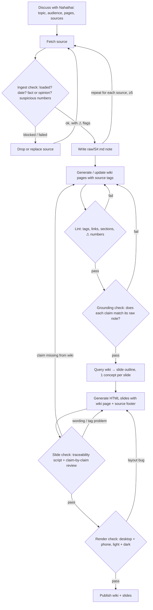

# Loop / graph design: Crypto Basics LLM Wiki → teaching slides

## Steps written out
Fetch data → write raw note → generate wiki pages → lint + grounding check → query wiki for the slide outline → generate slides → slide check → render check → publish.

## Which steps repeat?
- **Fetch → ingest check → raw note** repeats once per source. It ran 8 times: 7 sources succeeded and 1 (Investopedia) was blocked.
- **Generate wiki ↔ lint/grounding** repeats until both checks pass.
- **Generate slides ↔ slide check / render check** repeats until they pass.
- The **Slide check → wiki** edge is the important one. If a slide needs a fact the wiki doesn't contain, we don't just add it to the slide. We go back, add the fact to the wiki with its source tag (or drop it), and then regenerate. This keeps the wiki as the single source of truth.

## Where checks and regeneration happen

| Check | Type | Catches | On fail |
|---|---|---|---|
| Ingest check | LLM + human | blocked pages, missing dates, opinion vs fact, suspicious numbers (⚠) | refetch / replace source, flag number |
| Lint (`checks/lint.py`) | script | untagged claims, broken `[[links]]`, unknown source ids, missing sections, ⚠ numbers used | regenerate wiki page |
| Grounding check | LLM review | claims that say more than the source (overclaims, new terms, facts hidden in analogies) | rewrite claim |
| Slide check (`checks/slide_check.py` + review) | script + LLM | slides with no source, slides citing sources not on their wiki page, wording that drifts from the wiki | regenerate slide or go back to wiki |
| Render check (Playwright) | script | overflow, overlap, phone layout | fix CSS |

## Why this design?
- **Discuss first** means the human decides scope and audience before any text is generated, so the wiki covers what the user actually asked for (Pure added stablecoins, price/exchanges, P2P and "why crypto").
- **Source tags on every claim** make the check steps possible. With no tags, there is nothing to verify against.
- **Cheap script checks run before expensive LLM checks.** Scripts catch structural mistakes instantly. The LLM review is then used only for meaning.
- **The wiki is the only knowledge source for slides.** That keeps the slides and the wiki in clear correspondence, which the rubric asks for.
